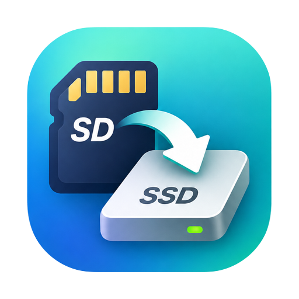
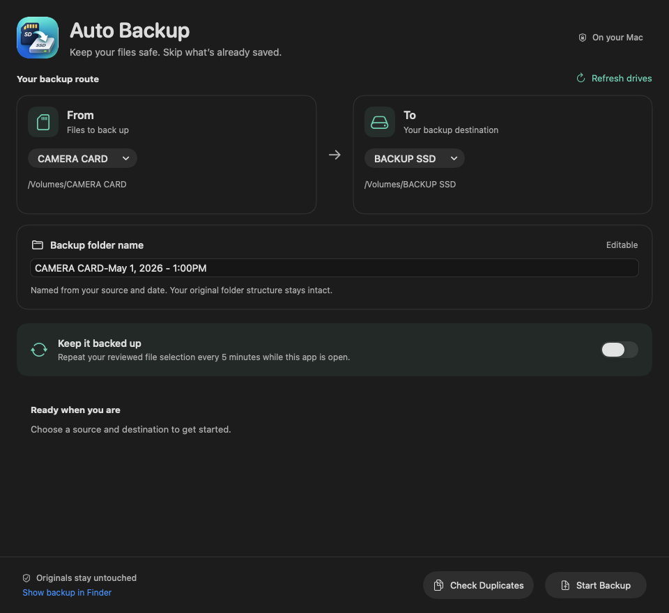
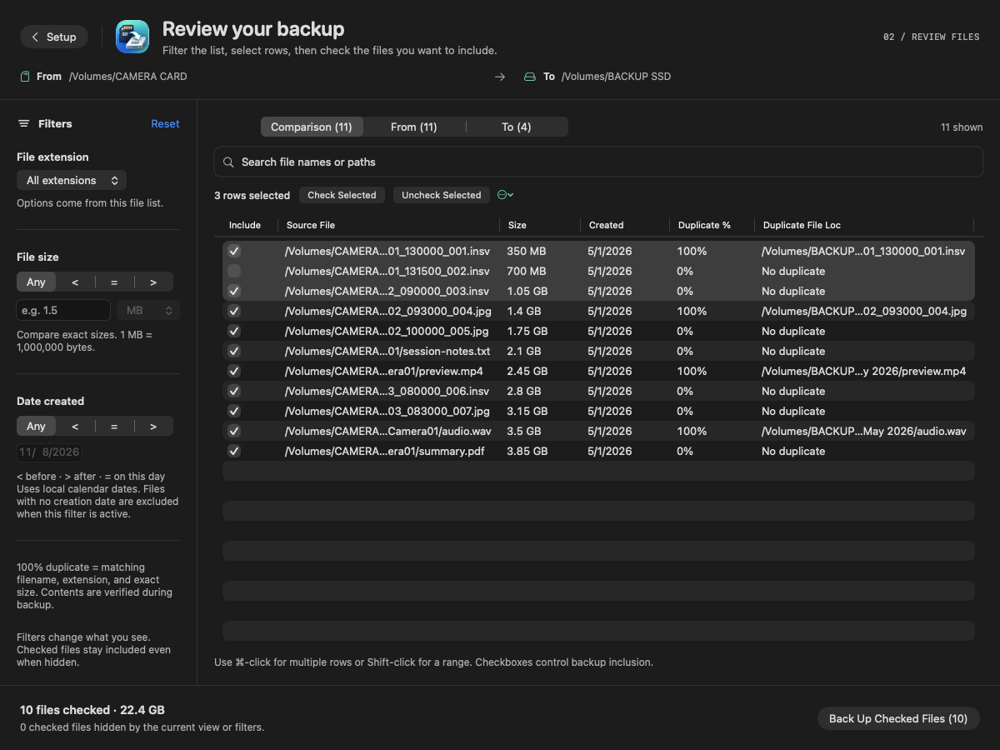
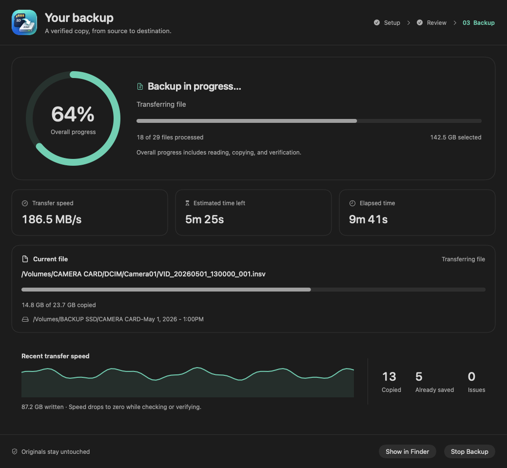

<div align="center">
  
  <h1>Auto Backup</h1>
  <p>A native Mac app for backing up SD cards, drives, and folders—with file review, verified copies, and clear progress.</p>

  [](https://github.com/Krissams/auto-backup/actions/workflows/ci.yml)
  [](LICENSE)
  [](CONTRIBUTING.md)
</div>

**Open source and built for the community.** Bug reports, ideas, documentation improvements, accessibility feedback, and pull requests are welcome. You do not need to be a Swift expert to help—[start here](CONTRIBUTING.md).

## Why Auto Backup?

- **Review before copying.** Scan both locations, inspect duplicate matches, and check only the files you want.
- **Skip verified copies.** Backup uses SHA-256 checks to recognize already-saved files at their expected paths. Name collisions keep both versions.
- **Filter large file lists.** Search paths, choose an extension from the scanned files, and filter by size or creation date with `<`, `=`, or `>`.
- **Work in batches.** Select rows with Command-click or Shift-click and check or uncheck them together.
- **See what is happening.** A dedicated progress page shows percentage, transfer speed, estimated time remaining, elapsed time, and the current file.
- **Repeat while open.** Optional five-minute backups reuse the selection you confirmed.
- **Keep everything local.** No account, upload service, analytics, or third-party package dependencies. Your file contents stay on your selected drives.

## A three-page workflow

| Step | What you do |
| --- | --- |
| **1 · Setup** | Choose From and To folders and a backup-folder name. |
| **2 · Review** | Check duplicates, filter the file list, and choose files to include. |
| **3 · Backup** | Follow copying and verification, stop safely, and inspect the result. |

<details>
<summary><strong>See the interface</strong> — screenshots use example data</summary>

### Setup



### Review files



### Backup progress



</details>

## Build and run

You need a Mac, macOS 13 or later, and Xcode or Apple's Command Line Tools with Swift 5.7 or later. The build uses the architecture of your current Mac: Apple silicon or Intel. Other operating systems are not supported.

```sh
git clone https://github.com/Krissams/auto-backup.git
cd auto-backup
zsh scripts/build.sh
open "build/Auto Backup.app"
```

If developer tools are missing, install them with `xcode-select --install`, then rerun the build. There is no package manager setup or API key to configure.

The script compiles Swift, packages the supplied logo into the app icon, and signs the app locally. It targets macOS 13 explicitly. Builds are ad-hoc signed for local use; they are not Apple-notarized releases. CI also builds a ZIP available in successful [workflow artifacts](https://github.com/Krissams/auto-backup/actions/workflows/ci.yml).

## Make your first backup

1. Connect the source and destination drives.
2. Choose **From** and **To**. A source-and-date folder name is filled in automatically; edit it if needed.
3. Click **Start Backup** to scan both folders and open the review page.
4. Uncheck files you want to leave out, then click **Back Up Checked Files**.
5. Wait for the result on the progress page and review any issues before disconnecting drives.

**Check Duplicates** opens a read-only comparison without starting a backup. For all controls, scheduling behavior, and recovery notes, see the [user guide](docs/USAGE.md).

## How duplicate detection works

The review table's **100%** means that the filename stem, extension, and exact byte size match. **It does not prove that the contents are identical.** The backup engine separately verifies file contents using SHA-256 before skipping an existing copy.

During backup, files keep their relative paths within the chosen backup folder. Different contents at an existing path are saved with a hash suffix, preserving the earlier copy. New copies are staged, verified, and moved into place. Source files are never deleted or rewritten.

Read the [matching and safety details](docs/USAGE.md#file-safety-and-matching). This is a file-backup utility, not a bootable-disk clone or a replacement for a tested recovery plan.

## Current limits

- Automatic backups run while the app is open and the Mac is awake. They include only the confirmed file selection; new files need a new review.
- Duplicate discovery searches the whole selected destination, but backup skipping checks the expected relative path and its conflict variants. There is no global content-deduplication index.
- Symbolic links and empty directories are not copied. Incomplete scans are marked and show their errors.
- Date filters use filesystem creation dates and local calendar days. Size filters use decimal units: 1 MB = 1,000,000 bytes.
- Abrupt termination can leave a hidden `.autobackup-*.partial` staging file. It is never counted as a completed copy.

## Development

```sh
# Run the temporary-file test suites.
zsh scripts/test.sh

# Build the application bundle.
zsh scripts/build.sh

# Render documentation screenshots with synthetic data.
zsh scripts/preview.sh
```

Tests cover backup verification, repeat runs, filename conflicts, path validation, cancellation, duplicate scanning, filters, bulk inclusion, navigation, progress, metadata preservation, and time estimates. They use disposable temporary folders rather than your camera cards. macOS CI runs the tests and build on pushes and pull requests.

See [architecture and file layout](docs/ARCHITECTURE.md) and the [contributor guide](CONTRIBUTING.md).

## Help shape the project

Have an idea or found a rough edge? [Open an issue](https://github.com/Krissams/auto-backup/issues/new/choose). Small improvements are valuable: clearer wording, reproducible bug reports, VoiceOver testing, documentation, and testing on different filesystems or Mac hardware.

Potential contributions include better recovery for disconnected drives, destination-filesystem compatibility, performance profiling with large file sets, and more accessibility testing. Discuss larger changes in an issue first so we can agree on the behavior.

Please follow our [community guidelines](CODE_OF_CONDUCT.md). Report vulnerabilities through the [security policy](SECURITY.md).

## License

[MIT](LICENSE) © 2026 Krissams and contributors. The license covers the source, documentation, and bundled artwork. You can use, modify, and redistribute the project under its terms.
