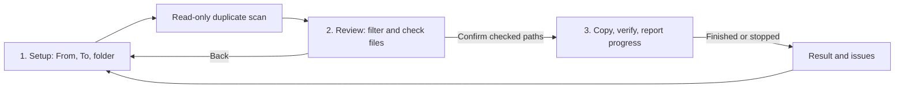

# Architecture

Auto Backup is a native macOS application using SwiftUI, AppKit, Foundation, CryptoKit, and system file APIs. There are no third-party runtime packages. Shell scripts compile the Swift sources directly and package the `.app` bundle.

## User flow

`BackupModel` coordinates the UI and background jobs. `showDuplicates` and `showProgress` select full pages in `BackupView`; review is not a modal. Filesystem work runs on a background queue, with changes to published UI state delivered to the main actor.

## Components

| File | Responsibility |
| --- | --- |
| `Sources/AutoBackupApp.swift` | App lifecycle, Dock icon, setup UI, scheduling, and `BackupModel`. |
| `Sources/DuplicateScanner.swift` | Read-only recursive inventories and filename/extension/size indexing. Captures byte size and optional creation date. |
| `Sources/FileReviewSession.swift` | Included paths, row highlighting, filters, and preservation of review state. |
| `Sources/DuplicateResultsView.swift` | Full-page review, tables, filter sidebar, bulk inclusion, and file details. |
| `Sources/BackupEngine.swift` | Validation, source inventory, selected-file copying, content verification, conflicts, and cancellation. |
| `Sources/BackupProgress.swift` | Structured telemetry, monotonic timing, weighted progress, transfer speed, and time estimates. |
| `Sources/BackupProgressView.swift` | Third-page progress ring, speed graph, current file, counters, and final result. |
| `scripts/prepare-branding.swift` | Packages the source logo into UI and Finder/Dock icon resources. |
| `scripts/render-previews.swift` | Renders screenshots from synthetic examples without scanning or backing up user files. |

## Two kinds of matching

The review scanner builds a destination index from filename stem, normalized extension, and exact byte size. A 100% review match means these metadata fields match. Stems are case-sensitive; extensions are normalized to lowercase. It lists every matching destination path and excludes the source file's own canonical path when folders overlap.

The backup engine separately hashes content with SHA-256. It checks the expected relative destination path and conflict-name variants. It does not use the scanner's metadata percentage as proof of identical contents and does not maintain a global content index.

## Copy lifecycle

For each included regular file, the engine:

1. Computes the source checksum and checks any existing copy.
2. Skips an existing copy only when its checksum matches.
3. Chooses a non-overwriting, hash-suffixed path when different contents already occupy the intended path.
4. Writes to a UUID-named hidden `.partial` file in the destination directory in 4 MiB chunks.
5. Synchronizes the staged data and copies file metadata with the system `copyfile` API.
6. Verifies the staged checksum and reads the source again to detect changes.
7. Moves the verified file to the final path without replacing an existing item.

Cancellation is protected by a lock and checked during reads and copying. A deferred cleanup removes a staged file on normal error or cancellation paths. Abrupt process termination can leave a hidden staged file; it is never counted as completed.

Source and target folders must not overlap. Destination symlinks are rejected. Source symlinks are skipped, and only included canonical source paths are processed when a reviewed selection is provided. Empty directories are not copied.

## Progress and scheduling

The engine first inventories included files to determine counts and byte totals. Progress allocates work across source reads, existing-copy checks, copying, and two verification reads, weighted by file size. Skips and errors count as processed. Progress remains below 100% until the run is finalized; issues remain visible even when processing has finished.

Copy speed is measured from bytes written during copying. It is zero during hashing and verification. Remaining time is estimated from completed work and elapsed monotonic time. UI telemetry is throttled to avoid publishing every chunk; phase transitions are published immediately. Empty files receive nonzero work weight to keep percentage calculations finite.

Automatic runs occur every five minutes while the app is open, awake, and idle, after a file selection has been confirmed. They reuse that selection. Changing source, destination, or backup-folder name clears approval. New files need another review. Automatic mode and approvals are not persisted across app launches.

## Local state and tests

Source/destination paths and the folder name are saved in `UserDefaults`. File contents are not uploaded; the app has no network service. Databases and file manifests are not required.

`Tests/` contains standalone executable test suites. Fixtures live in temporary folders, including tests of conflicts, duplicate scans, filters, navigation, selected-file enforcement, metadata, chunk-level cancellation, and deterministic time estimates. See [CONTRIBUTING.md](../CONTRIBUTING.md) for commands and test expectations.
